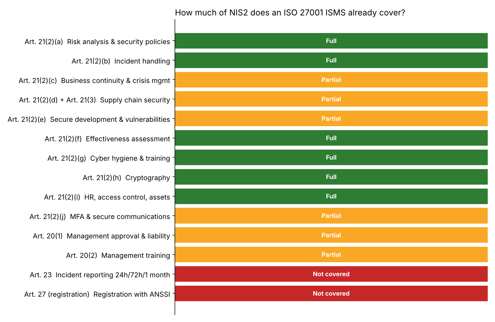

# NIS2 → ISO 27001 gap mapping (space sector case)

**Question:** if a company already runs an ISO 27001 ISMS, how much of the EU NIS2 Directive does it already meet, and what is missing?

I mapped every NIS2 cybersecurity obligation (Article 21 measures, plus Articles 20, 23 and 27) to the ISO/IEC 27001:2022 clauses and Annex A controls that cover it. For each one I rated the coverage (Full / Partial / Not covered), described the gap and proposed an action to close it. I then checked whether NIS2 applies to a space / Earth-observation company in France, and where French transposition stands.



## Key results

- **6 of the 10 Article 21(2) measures are fully covered** by a well-run ISO 27001 ISMS (risk analysis, incident handling, effectiveness assessment, cyber hygiene and training, cryptography, HR / access / assets).
- **4 measures are partly covered:** crisis management, supplier-specific assessment (Art. 21(3)), coordinated vulnerability disclosure, and mandatory MFA / secured emergency communications.
- **The biggest gaps are outside Article 21:** the incident reporting deadlines of Article 23 (24h early warning, 72h notification, 1-month final report) and registration with the authority (ANSSI in France). ISO 27001 has no equivalent.
- **Management duties (Art. 20)** go further than ISO 27001: formal approval of the measures, personal liability and mandatory training for the management body.
- **Applicability:** a space company is not automatically in scope. Only operators of ground-based infrastructure fall under the "space" sector (Annex I). Satellite manufacturers can be in scope as manufacturers (Annex II). See [docs/applicability_space_sector.md](docs/applicability_space_sector.md).

## Repository content

| File | What it is |
|---|---|
| `data/nis2_iso27001_mapping.csv` | The mapping: 14 NIS2 requirements, matching ISO 27001 clauses and Annex A controls, coverage rating, gap, action |
| `scripts/coverage_summary.py` | Prints the coverage summary and the list of gaps, and draws the chart |
| `outputs/coverage_chart.png` | Coverage chart |
| `docs/applicability_space_sector.md` | Does NIS2 apply to a space company? + French transposition status (Nov 2026) |

## How to run

```bash
pip install -r requirements.txt
python scripts/coverage_summary.py
```

## Method

1. Listed the obligations from the NIS2 text on EUR-Lex: Art. 21(2)(a) to (j), Art. 21(3), Art. 20(1)-(2), Art. 23(4), Art. 27.
2. For each one, found the ISO 27001:2022 clauses (4 to 10) and Annex A controls (5.x organisational, 6.x people, 7.x physical, 8.x technological) that address it.
3. Rated coverage: **Full** = the ISO requirement achieves the same result; **Partial** = ISO covers the topic but NIS2 asks for something more specific; **Not covered** = no ISO equivalent.
4. Wrote one concrete action per gap.
5. Checked applicability for the space sector (Annex I and II) and the French transposition status.

## Limits

- The coverage ratings are my own analysis, not an official mapping. ANSSI publishes a comparison tool (ReCyF vs other frameworks, including ISO 27001) that should be used to confirm them.
- "Full" means the ISO 27001 *requirement* covers the NIS2 measure. A certificate alone is not proof: the scope of the ISMS must include the systems that NIS2 covers.
- French law is not final yet (November 2026), so national details may change.

## Sources

- NIS2 Directive (EU) 2022/2555, EUR-Lex: https://eur-lex.europa.eu/eli/dir/2022/2555/oj
- ANSSI, La directive NIS 2 and ReCyF: https://cyber.gouv.fr/la-directive-nis-2
- ANSSI, Guide d'hygiène informatique and EBIOS Risk Manager guide (cyber.gouv.fr)
- ISO/IEC 27001:2022 Annex A control list (titles only; the standard itself is not free)
